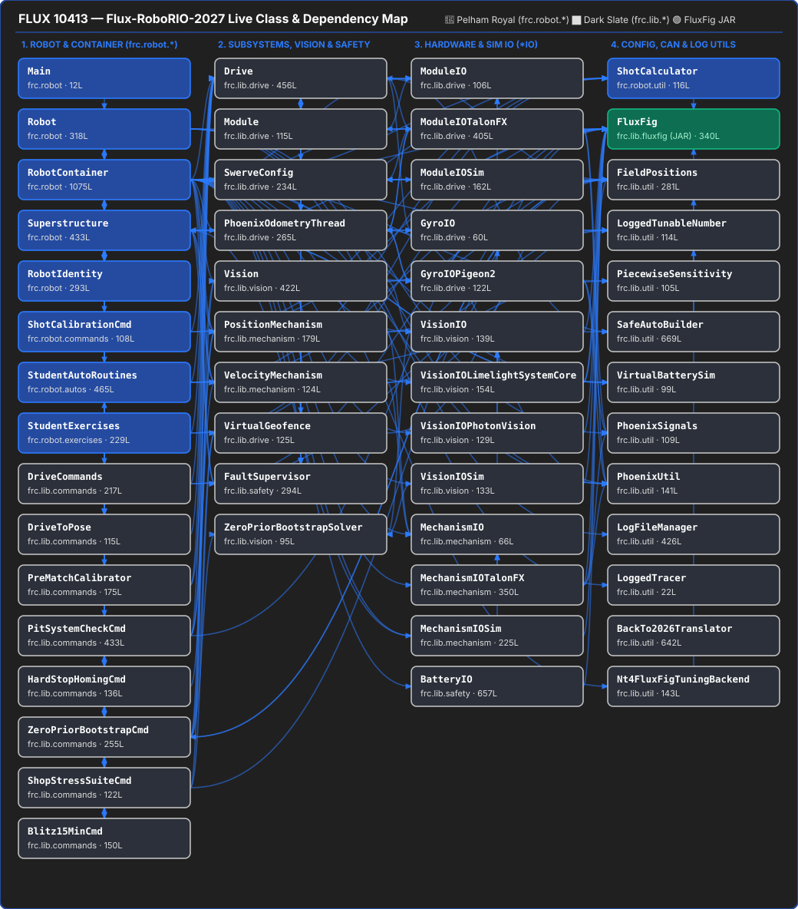

# Flux-RoboRIO-2027 — FRC Team 10413 (FLUX Robotics)


RoboRIO 2.0 + CTRE CANivore robot repository for **FRC Team 10413 (FLUX Robotics)** (`FUEL`, `CORAL`, `CHASSIS_3`, and `COMP_2027:roborio_fallback`). Consumes the shared **`frc.lib.*`** core engine (`drive`, `vision`, `mechanism`, `safety` including `BatteryIO`, `commands`, `util`) 1:1 from [`Flux-SystemCore-2027`](https://github.com/FRC-Flux-Robotics/Flux-SystemCore-2027) via `./gradlew backTo2026`, while maintaining **2026 `FUEL`-only shooting mechanisms, math, and calibration commands** (`Superstructure`, `ShotCalculator`, `ShotCalibrationCmd`, `range_table.csv`) exclusively inside `src/main/java/frc/robot/`.

---

## Live Cloud Build Artifacts (`gs://btvaroska/frc-10413/`)
* **Latest Interactive Precision Scorecard:** [`precision-scorecard.html`](https://storage.cloud.google.com/btvaroska/frc-10413/builds-roborio/latest/precision-scorecard.html)
* **Latest Student Default Autonomous (`STUDENT` Starter):** [`student-auto.mp4`](https://storage.cloud.google.com/btvaroska/frc-10413/builds-roborio/latest/student-auto.mp4) | [`student-auto.html` (Interactive 3D Viewer)](https://storage.cloud.google.com/btvaroska/frc-10413/builds-roborio/latest/student-auto.html)
* **Latest `"Hub to Depot"` Reference Showcase (`FUEL`):** [`hub-to-depot-auto.mp4`](https://storage.cloud.google.com/btvaroska/frc-10413/builds-roborio/latest/hub-to-depot-auto.mp4) | [`hub-to-depot-auto.html` (Interactive 3D Viewer)](https://storage.cloud.google.com/btvaroska/frc-10413/builds-roborio/latest/hub-to-depot-auto.html)
* **Interactive Class & Dependency Explorer:** [`docs/class-map.html`](docs/class-map.html) *(also published to [`class-map.html` on GCS](https://storage.cloud.google.com/btvaroska/frc-10413/builds-roborio/latest/class-map.html) and [`frc-flux-robotics.github.io/class-map-roborio-2027.html`](https://frc-flux-robotics.github.io/class-map-roborio-2027.html))*
* **Latest Offline Robot Package (`.fluxpkg.zip`):** [`STABLE_v2027.1.0_roborio-2026_fluxpkg.zip`](https://storage.cloud.google.com/btvaroska/frc-10413/builds-roborio/latest/STABLE_v2027.1.0_roborio-2026_fluxpkg.zip)
* **Student Developer Guide:** [`STUDENTS.md`](STUDENTS.md) | [`STUDENT-CHANGELOG.md`](STUDENT-CHANGELOG.md)

---

## Student Quick-Start (Zero Cloud Access Needed) & 2026 Hub Shooting Cycle
Students only need **2 required installs** + **3 optional tools** to edit, simulate, and render 3D autonomous routines on the **2026 REBUILT field** (`FUEL` robot with floor `FUEL` ball intake, `ShotCalculator` Shoot-on-the-Move aiming, and 3D parabolic shots into the Blue Hub at `(4.63m, 4.21m, Z=1.83m)`) with zero physical robot or cloud credentials:
1. **WPILib 2026 VS Code Installer (includes JDK 17 & GradleRIO)** — required.
2. **Git** — required.
3. **PathPlanner GUI** (`winget install MJansen4857.PathPlanner` on Windows or [GitHub Releases](https://github.com/mjansen4857/pathplanner/releases)) — optional; open this repository root (`File -> Open Project`) to visually draw or edit splines under **Paths** (`src/main/deploy/pathplanner/paths/*.path`), then call `resetPoseToPathStart(drive, "My Path")` + `withLoopTimeout(drive.followPathCommand("My Path"), 5.5)` in [`StudentAutoRoutines.java`](src/main/java/frc/robot/autos/StudentAutoRoutines.java) *(note: `renderAuto` executes `.path` files wired in `StudentAutoRoutines.java`, not GUI `.auto` files)*.
4. **AdvantageScope** — optional; recommended for live 3D telemetry (`./gradlew simulateJava`).
5. **`ffmpeg`** (`winget install Gyan.FFmpeg` on Windows or `brew install ffmpeg` on Mac) — optional; enables `.mp4` video encoding alongside the interactive 3D `.html` viewer.

### Write & Render Your Own 15-Second Autonomous Routine (`./gradlew renderAuto`)
1. **Edit the Empty `STUDENT` Starter Auto:** Open [`src/main/java/frc/robot/autos/StudentAutoRoutines.java`](src/main/java/frc/robot/autos/StudentAutoRoutines.java) and follow the `// STUDENT:` note inside `createStudentDefaultAuto(...)` (selected by default in `Auto/Chooser` and rendered by `./gradlew renderAuto`):
   - **Track A — Fixed Code Moves:** Use `driveRelative(drive, forwardM, leftM, turnDeg, timeoutSec)`, `driveTimedVelocity(drive, vxMps, vyMps, omegaDegPerSec, sec)`, `DriveToPose`, and `waitLoopSeconds(sec)` — see `createFixedMovesExampleAuto(...)`. *(Always use `waitLoopSeconds` and `withLoopTimeout` rather than `Commands.waitSeconds` / `.withTimeout` so fast-forward `renderAuto` simulation advances!)*
   - **Track B — PathPlanner `.path` Moves:** Use `resetPoseToPathStart(drive, "<path>")` + `withLoopTimeout(drive.followPathCommand("<path>"), sec)` — see `createFullCyclePathPlannerAuto(...)` ([`"Hub to Depot.path"`](src/main/deploy/pathplanner/paths/Hub%20to%20Depot.path) $\rightarrow$ [`"Collect.path"`](src/main/deploy/pathplanner/paths/Collect.path)), [`"Left to Depot.path"`](src/main/deploy/pathplanner/paths/Left%20to%20Depot.path), and [`"Right to Depot.path"`](src/main/deploy/pathplanner/paths/Right%20to%20Depot.path).
2. **Render Locally or in Cloud Build:**
   ```bash
   ./gradlew renderAuto                              # Renders your STUDENT auto (createStudentDefaultAuto)
   ./gradlew renderAuto -Pauto=list                  # Lists all named STUDENT & EXAMPLE routines
   ./gradlew renderAuto -Pauto="Fixed Code Moves"    # Renders Track A Fixed Code Moves example
   ./gradlew renderAuto -Pauto="PathPlanner 2-Path"  # Renders Track B Hub to Depot + Collect chain
   ./gradlew renderAuto -Pauto="Hub to Depot"        # Renders Hub to Depot showcase
   ```
   *(If `../FluxProcessor` is not cloned locally, Gradle automatically shallow-clones public `FRC-Flux-Robotics/FluxProcessor` into gitignored `build/tools/FluxProcessor`.)*
3. **Watch:** Open `build/auto-sim/student-auto.html` (full interactive 3D Hub + Depot + `FUEL` ball browser viewer, zero `ffmpeg` required) or `build/auto-sim/student-auto.mp4`.

### Practice the 4-Level Student Exercise Kit (`./gradlew checkExercises`)
Open [`src/main/java/frc/robot/exercises/StudentExercises.java`](src/main/java/frc/robot/exercises/StudentExercises.java) and run the auto-grader:
```bash
./gradlew checkExercises
```
* **Level 1 (10 min):** `FluxFig` `MechanismSpec` & Hardware Safety Validation (CANivore bus validation, clamping `statorLimitAmps <= 60 A` / `supplyLimitAmps <= 40 A`).
* **Level 2 (15 min):** `Superstructure` Shot-Release Interlock (`Shooter` $\pm 2.0\text{ RPS}$ and `Hood` $\pm 0.15\text{ rot}$ readiness gate before spinning the Feeder).
* **Level 3 (20 min):** Swerve Pose & Shortest-Path Heading Controller (`MathUtil.angleModulus` across $\pm 180^\circ$).
* **Level 4 (25 min):** 15-Second Multi-Volley Hub Autonomous (`PREPPING_SHOT` $\rightarrow$ `SHOOTING` $\rightarrow$ `"Hub to Depot.path"` $\rightarrow$ second Hub volley).

---

## Live Class & Dependency Architecture Map
> **Auto-generated on every update by `./gradlew updateStudentDocs` (`scripts/generate_class_map.py`)** and verified in Tier 1 CI. See [`STUDENTS.md`](STUDENTS.md) for the full class table or open [`docs/class-map.html`](docs/class-map.html) for the interactive clickable explorer.



---

## 5-Tier Automated Verification & Precision Gate
Every commit and manual `gcloud builds submit` runs all 5 verification tiers headlessly on GCP Cloud Build (`eclipse-temurin:17-jdk-jammy` with real C++ `libCTRE_SimProTalonFX.so`, `libCTRE_SimProCANcoder.so`, `libCTRE_SimProPigeon2.so` + WPILib `DCMotorSim`) and posts 6 commit status checks back to GitHub:

| Tier | Status Check Context | What It Verifies & Quantitative Gate |
| :--- | :--- | :--- |
| **Tier 1** | `flux/tier-1-hygiene` | `0` forbidden `SmartDashboard`/`Preferences` calls, `0` per-loop `ControlRequest` allocations, `BackTo2026` 1:1 sync, and [`STUDENTS.md`](STUDENTS.md) / [`STUDENT-CHANGELOG.md`](STUDENT-CHANGELOG.md) sync. |
| **Tier 2** | `flux/tier-2-solvers` | `FluxFig` 1-cell controller fallback & SHA-256, `FieldPositions` 2026 $\leftrightarrow$ 2027 coordinate bijection ($\le 0.01\text{ mm}$), `VirtualGeofence` 10,000-vector $5\text{ m} \times 3\text{ m}$ shop stress (`0` breaches), `ZeroPriorBootstrapSolver` `AX=XB` camera extrinsics ($\le 5.0\text{ mm}$, $\le 0.5^\circ$), and `ShotCalculator` Shoot-on-the-Move & `Superstructure` shot-release interlock. |
| **Tier 3** | `flux/tier-3-ctre-sim` | Real C++ CTRE Phoenix 6 `TalonFXSimState` + `DCMotorSim` closed-loop Kraken X60 velocity tracking ($\pm 0.37\text{ RPS}$) and hardware configurator register readback (`60.0 A` Stator / `40.0 A` Supply, blocking `.withSlipCurrent(120 A)` overwrites). |
| **Tier 4** | `flux/tier-4-chaos-match` | 150-second (7,500-loop) 50x fast-forward full match simulation (`SimHooks.stepTiming(0.020)`) with `FaultSupervisor` injecting a $28\text{ m}\Omega$ weak battery ($V_{\min} \ge 7.50\text{ V}$, `0` brownouts), $+12\text{ cm}$ bent camera mount (`80 ms` quarantine), 2 indexer stall jams (`2/2` `-4V` reverse auto-clears), 3s AprilTag blackout, and steer CANcoder fault. |
| **Tier 5** | `flux/tier-5-nytr-replay` | Binary `.wpilog` replay of **2026 NYTR Qual 53 (`Blue 3`, `FUEL`)** acceleration & shot load demand through the 2027 `60 A`/`40 A` clamp + `FaultSupervisor`, proving `0` enable dropouts ($V_{\min} = 9.33\text{ V}$) vs. `15` mid-match dropouts ($V_{\min} = 6.23\text{ V}$) in legacy 2026. |
| **Package** | `flux/packages` | Builds and publishes `STABLE_v2027.1.0_roborio-2026_fluxpkg.zip` with `manifest.json`, embedded `.java` sources, and `FluxFig` CSV configs for 4-second offline deployment via `FluxTray.jar`. |

---

## `FluxFig` Standalone Library & 3-Path Build/Deploy Workflow
[`FluxFig`](https://github.com/FRC-Flux-Robotics/FluxFig) lives in its own zero-dependency Java 17 repository so the exact same JAR (`fluxfig-1.0.0.jar`) is shared across `Flux-SystemCore-2027`, `Flux-RoboRIO-2027`, `FluxTray.jar`, and `FluxProcessor`:
1. **Students / Offline Pit Laptop (`Flux-RoboRIO-2027` cloned alone):**
   - When `../FluxFig` is not present locally, `syncLocalFluxFig` is a no-op and Gradle compiles directly against the committed [`libs/fluxfig-1.0.0.jar`](libs/fluxfig-1.0.0.jar) with zero extra clones or cloud credentials required.
   - Running `./gradlew renderAuto` automatically shallow-clones and builds public `FRC-Flux-Robotics/FluxProcessor` into gitignored `build/tools/FluxProcessor` if `../FluxProcessor` is not cloned locally.
2. **Mentor / Multi-Repo Local Dev (`../FluxFig` cloned alongside this repo):**
   - Running `./gradlew build` or `./gradlew test` in this repo triggers `syncLocalFluxFig`, which pulls `../FluxFig/dist/fluxfig.jar` into [`libs/fluxfig-1.0.0.jar`](libs/fluxfig-1.0.0.jar) whenever `../FluxFig/dist/fluxfig.jar` is present.
3. **GCP Cloud Build (`cloudbuild.yaml`):**
   - `FluxFig/cloudbuild.yaml` publishes `gs://btvaroska/frc-10413/libs/fluxfig-latest.jar`, and Step `0` of [`cloudbuild.yaml`](cloudbuild.yaml) pulls `gs://btvaroska/frc-10413/libs/fluxfig-latest.jar` into `/workspace/libs/fluxfig-1.0.0.jar`.

---

## Running Cloud Build Verification Manually
```bash
gcloud builds submit . \
  --config=cloudbuild.yaml
```
